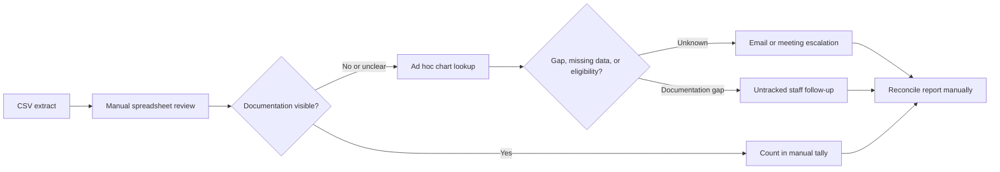
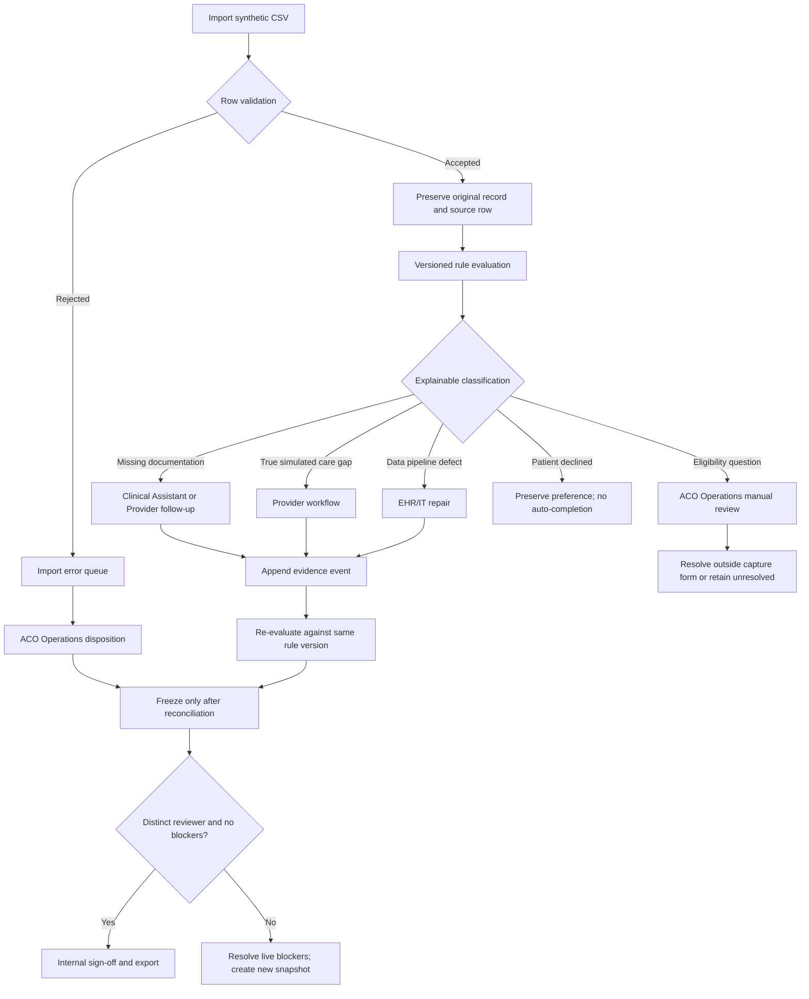

# Workflow Maps

All flows below are simulated. The burden values are planning assumptions for a portfolio exercise, not observed staff time or a service-level commitment.

## Current-state assumption

Assumed handling effort: 3-8 minutes per record for initial review, with additional follow-up time not estimated because the current state lacks workflow telemetry. Main risks are inconsistent rule versions, undocumented ownership, silent denominator changes, and no immutable reviewer evidence.

## Proposed-state workflow

## Handoffs and exception paths

| Classification | Primary handoff | Allowed evidence path | Exception |
| --- | --- | --- | --- |
| Missing documentation | Clinical Assistant; Provider may also complete | Documentation completion event, dated assessment fields, evidence | If documentation shows the assessment was not completed, reclassify and route to Provider; do not claim completion |
| True care gap | Provider | Simulated care event with evidence | The app does not recommend or prescribe treatment; patient preference, contraindications, and clinician judgment remain outside this rule |
| Data pipeline defect | EHR/IT | Data repair event linked to source evidence | Keep unresolved and block sign-off if source cannot be validated |
| Patient declined | Provider / care team | Preserve the decline and optionally record follow-up assignment | No automated completion; the choice is not a negative performance judgement |
| Eligibility question | ACO Operations | Manual review outside the point-of-care capture path | Retain unresolved until eligibility evidence is established |
| Malformed import | ACO Operations | Explicit batch disposition | Rejected rows do not enter the denominator |
| Reporting blocker | ACO Operations preparer and independent reviewer | New snapshot after live correction; reviewer sign-off with evidence | Do not alter the content of an existing snapshot |

## Burden assumptions for pilot planning

- CSV batch review: 5-15 minutes per batch, excluding source-system correction.
- Routine queue triage: 1-3 minutes per record to verify classification and assign an owner.
- Documentation follow-up: 3-8 minutes per record, assumed and not measured.
- Data defect investigation: 10-30 minutes per record, assumed and highly variable.
- Snapshot reconciliation and independent review: 20-45 minutes per package, assumed.

These are workload-planning placeholders only. A real pilot should measure actual time, rework, and appropriateness before making staffing or savings claims.